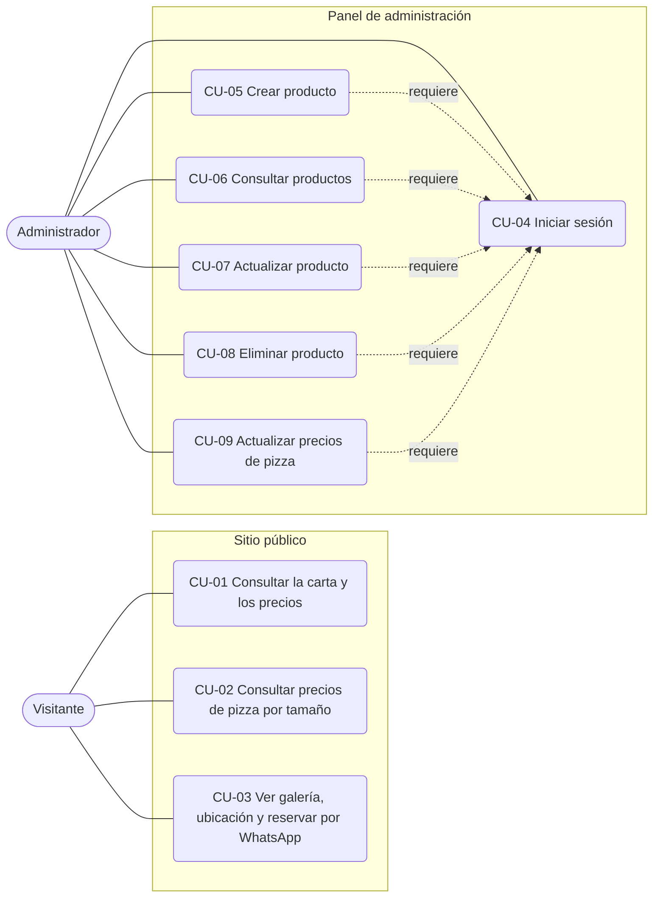

# Casos de uso

## Diagrama de casos de uso

## Especificación de los casos de uso CRUD

### CU-05 Crear producto (insertar)

| Campo | Descripción |
|---|---|
| Actor | Administrador |
| Precondición | Tiene sesión iniciada y eligió una categoría. |
| Flujo principal | 1. Pulsa "Nuevo producto". 2. Completa nombre, precio y demás datos. 3. Pulsa "Guardar". 4. El sistema valida los datos. 5. El sistema guarda el producto. 6. El sistema regresa al listado de la categoría. |
| Flujo alterno | 4a. Hay datos inválidos (nombre vacío, precio no numérico, etc.): el sistema no guarda y muestra los errores. |
| Postcondición | El producto existe en la base de datos y aparece en el sitio si está visible. |
| Clases | `MenuItemValidator`, `MenuItem`, `MenuItemRepository::create()` |

### CU-06 Consultar productos

| Campo | Descripción |
|---|---|
| Actor | Administrador (panel) y Visitante (sitio, solo visibles) |
| Precondición | Existe al menos una categoría. En el panel, tiene sesión iniciada. |
| Flujo principal | 1. Elige una categoría. 2. El sistema consulta sus productos. 3. El sistema los muestra agrupados por subcategoría. |
| Flujo alterno | 2a. La categoría no tiene productos: se muestra el mensaje "Todavía no hay productos en esta categoría". |
| Postcondición | No cambia ningún dato. El panel muestra también los productos ocultos. |
| Clases | `MenuItemRepository::findByCategory()` y `findById()` |

### CU-07 Actualizar producto

| Campo | Descripción |
|---|---|
| Actor | Administrador |
| Precondición | Tiene sesión iniciada y el producto existe. |
| Flujo principal | 1. Pulsa el lápiz del producto. 2. El sistema carga el formulario con sus datos. 3. Modifica los datos y guarda. 4. El sistema valida y actualiza. |
| Flujo alterno | 2a. El producto no existe o es de otra categoría: se regresa al listado. 4a. Datos inválidos: no se guarda y se muestran los errores. |
| Postcondición | El producto queda con los datos nuevos y el cambio se ve de inmediato en el sitio. |
| Clases | `MenuItemValidator`, `MenuItem`, `MenuItemRepository::update()` |

### CU-08 Eliminar producto

| Campo | Descripción |
|---|---|
| Actor | Administrador |
| Precondición | Tiene sesión iniciada y el producto existe. |
| Flujo principal | 1. Pulsa el icono de eliminar. 2. El navegador pide confirmación. 3. Confirma. 4. El sistema elimina el producto. |
| Flujo alterno | 3a. Cancela: no ocurre nada. |
| Postcondición | El producto ya no existe en la base de datos ni en el sitio. |
| Clases | `MenuItemRepository::delete()` |
