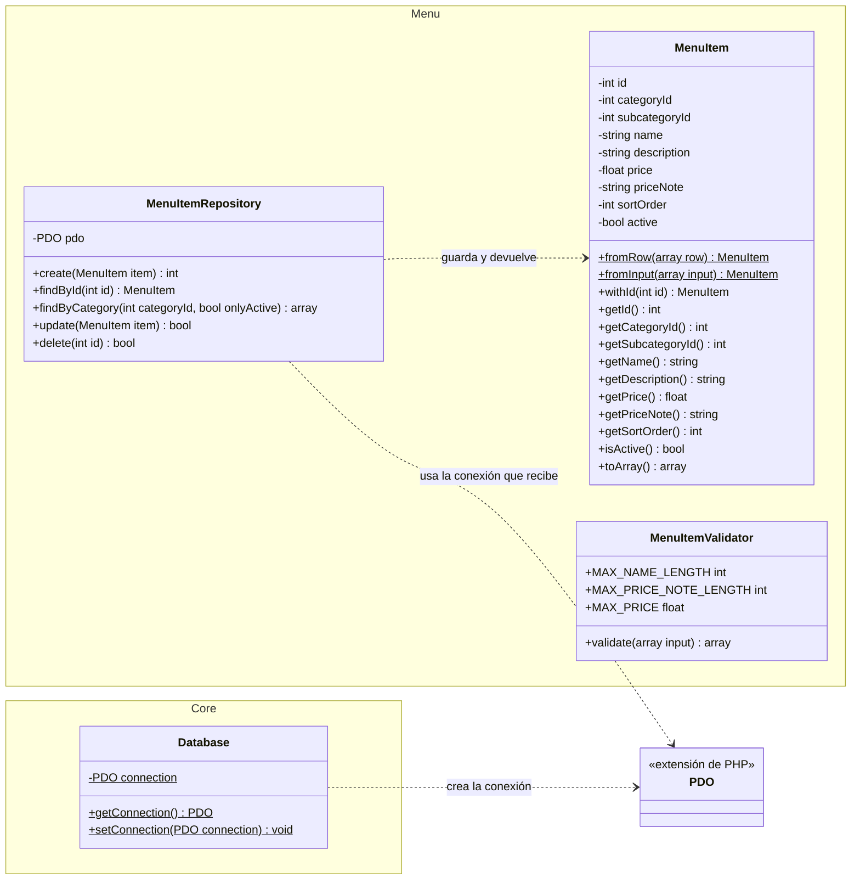
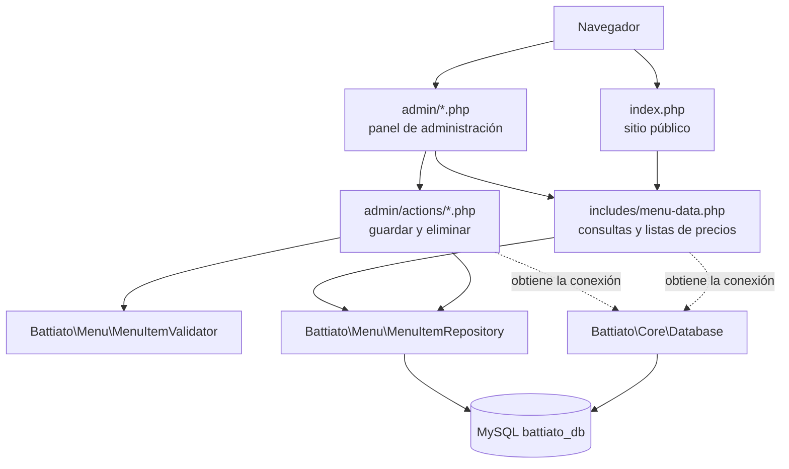

# Diagrama de clases y arquitectura

## Diagrama de clases

Los paquetes (espacios de nombres) son `Battiato\Core` y `Battiato\Menu`, y cada uno corresponde a una carpeta dentro de `src/`.

El `MenuItemValidator` no depende de otras clases: recibe el arreglo del formulario y devuelve los errores. Si no hay errores, `MenuItem::fromInput()` construye el producto con esos mismos datos.

## Arquitectura por capas

`getDbConnection()` (en `config/database.php`) es un atajo de `Database::getConnection()`. Las funciones de `includes/menu-data.php` y `admin/includes/auth.php` siguen siendo procedurales; el módulo de productos (CRUD) es el que está orientado a objetos.
