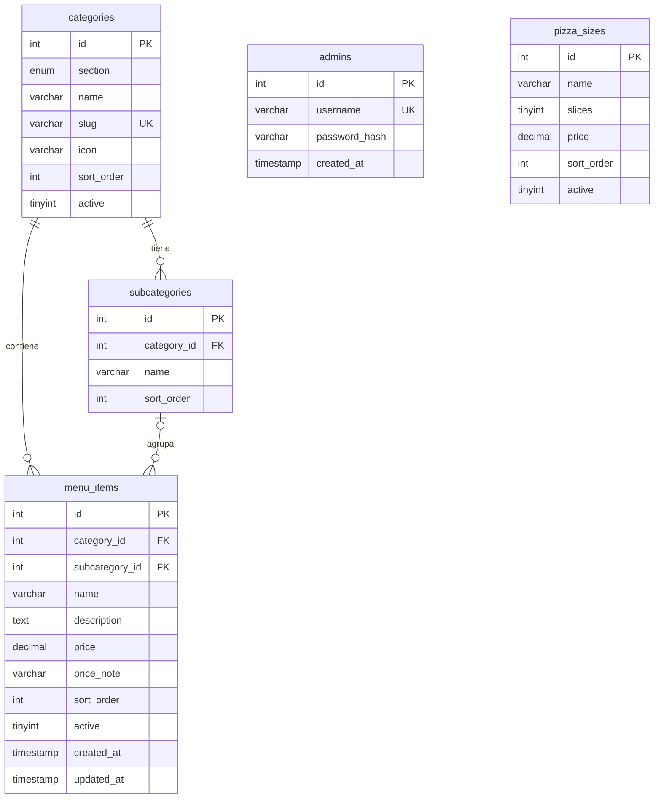

# Modelo de datos (MySQL `battiato_db`)

Definido en `database/schema.sql`.

- Al borrar una categoría se borran sus subcategorías y productos (`ON DELETE CASCADE`).
- Al borrar una subcategoría, sus productos quedan sin subcategoría (`ON DELETE SET NULL`).
